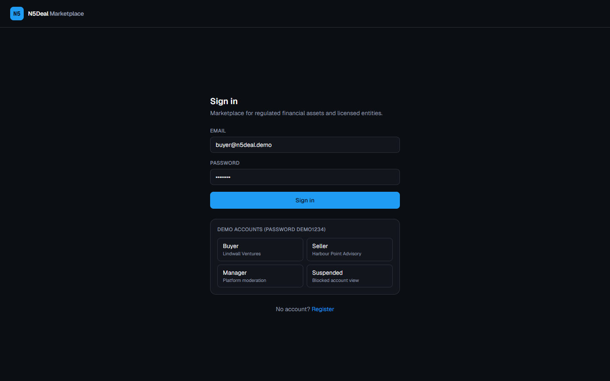
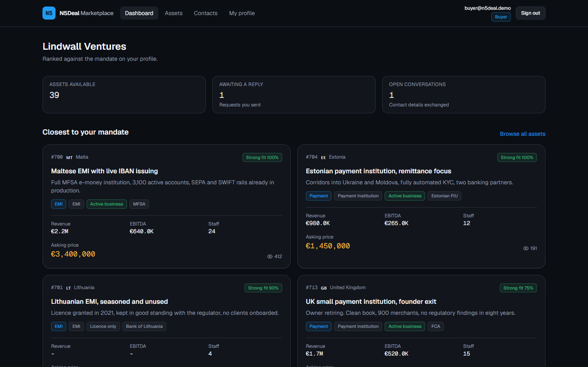
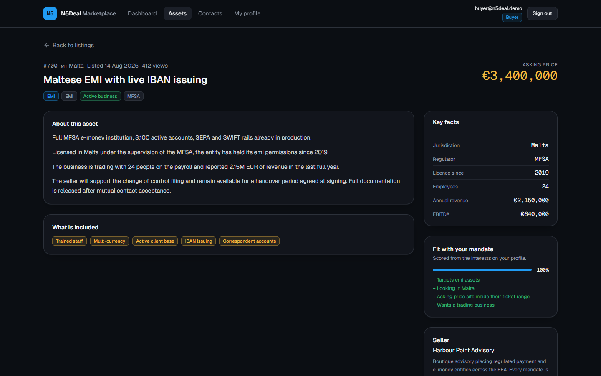
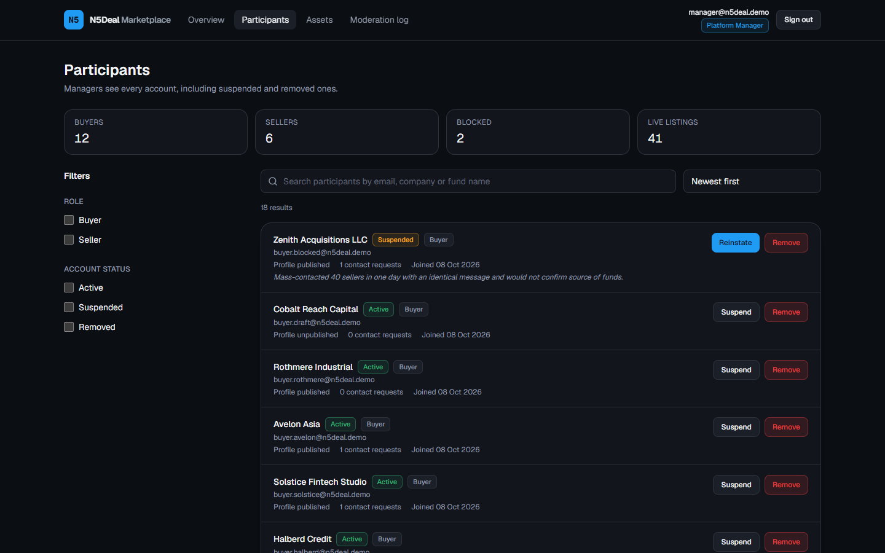
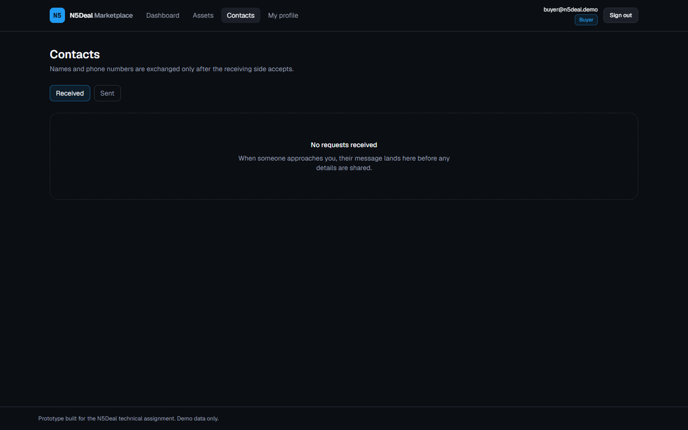

# N5Deal Marketplace Prototype

The version submitted for the assignment is tagged `submitted`.

A marketplace for M&A in regulated financial services: sellers list licensed entities and operating businesses, buyers publish mandates, and a platform manager moderates both sides. Built as a technical assignment, so a prototype rather than a production system.

## Screenshots

**Sign-in with one-click demo accounts**


**Buyer dashboard, assets ranked against the mandate**


**Asset page with mandate fit breakdown**


**Platform manager: participant moderation**


**Contact requests between buyers and sellers**


## Run it

Needs Node 18.18 or newer. The database is a local SQLite file, nothing else to configure.

```bash
npm install
npm run db:setup          # creates .env if missing, generates AUTH_SECRET, applies migrations, seeds demo data
npm run dev
```

### Configuration

| Variable | Notes |
| --- | --- |
| `DATABASE_URL` | SQLite file, `file:./dev.db` by default |
| `AUTH_SECRET` | Empty in `.env.example`. `npm run db:setup` writes a random one into `.env` if it is missing. In production the server refuses to start when it is unset or a known demo value. Set your own with `openssl rand -base64 32` |
| `DEMO_MODE` | `true` in `.env.example`. Shows the one-click demo accounts on the login page and seeds the 19 demo accounts. Without it the login page has no demo accounts and the seed only creates the reference lists (categories, jurisdictions, benefits). Remove it for any real deployment |
| `AUTH_TRUST_HOST` | Commented out. Set it to `true` only when the production build runs behind a proxy or off localhost |

Open http://localhost:3000 (or http://127.0.0.1:3000 if `localhost` resolves to IPv6 first). `npm run db:reset` wipes and reseeds; the seed is deterministic.

### Demo accounts

Password for all of them is `demo1234`.

| Role | Email | What you see |
| --- | --- | --- |
| Buyer | `buyer@n5deal.demo` | Published mandate, ranked assets, open conversations |
| Seller | `seller@n5deal.demo` | Five live listings, one draft, incoming requests |
| Platform manager | `manager@n5deal.demo` | Participants, all assets, moderation log |
| Suspended buyer | `buyer.blocked@n5deal.demo` | The blocked-account view with its reason |
| Buyer, unpublished | `buyer.draft@n5deal.demo` | The onboarding gate before a profile goes live |

The seed has 19 accounts, 43 assets across 20 jurisdictions and 17 contact requests in every status.

## Scope

Three roles, a persistent data model, search on both sides of the marketplace, and a contact flow with a real gate.

- **Buyer:** maintains a mandate, browses and filters assets, sees a fit score against it, contacts sellers.
- **Seller:** publishes assets through draft and publish, browses buyers, sees which buyers fit the newest listing, contacts them.
- **Manager:** searches participants and assets, suspends, reinstates and removes participants, suspends and republishes listings, reads an append-only moderation log.

Not built: email delivery, NDA workflow, document room, payments, email verification, password reset, rate limiting.

### Where to look

| File | Why |
| --- | --- |
| [`src/lib/auth/policies.ts`](src/lib/auth/policies.ts) | Every non-trivial permission rule, as pure functions |
| [`src/lib/search/params.ts`](src/lib/search/params.ts) | The facet engine behind all three catalogues |
| [`src/app/actions/moderation.ts`](src/app/actions/moderation.ts) | Suspend, remove and the cascade each one triggers |
| [`src/lib/match.ts`](src/lib/match.ts) | Fit scoring, deterministic and explainable |
| [`prisma/schema.prisma`](prisma/schema.prisma) | The data model and the constraints doing real work |

## Key decisions

**Server components and server actions, no API layer.** Pages query Prisma directly and every mutation is a server action. A REST or tRPC layer in between would only forward calls. The cost is coupling to Next.

**SQLite through Prisma.** `npm install && npm run db:setup && npm run dev` works on a clean machine. SQLite has no enums or scalar lists, so enum-like columns are TEXT with the allowed values in [`src/lib/domain/enums.ts`](src/lib/domain/enums.ts), and buyer categories and jurisdictions are join tables. Moving to Postgres is a provider swap plus native enums.

**Search state lives in the URL.** A filtered view survives refresh and works as a shareable link. [`params.ts`](src/lib/search/params.ts) parses the query string against a declared facet config and drops anything not in it, so a hand-edited URL cannot put an unexpected value into a query. Assets, buyers and participants share one engine; only the Prisma where-clause differs.

**Authorisation is a policy module, and suspension is checked on every request.** `policies.ts` has pure functions with no database or session; [`guards.ts`](src/lib/auth/guards.ts) is the only place a session is read. The JWT holds user id and role, while account status is read from the database per request, so a suspension applies on the next click.

**Contact details are gated.** A request carries a message and nothing else. Names, emails and phone numbers are released to both sides only once the receiving side accepts. The answer is a conditional update on the PENDING row, so a double submit cannot turn a decline into an accept, and unique indexes stop duplicate outreach.

## Tests

```bash
npm test
```

Vitest unit tests cover the pure modules: the permission rules in `policies.ts` (roles, suspended accounts, ownership, self-contact, who sees contact details), the fit scoring in `match.ts` (weights, ticket range boundaries, label thresholds, reasons and misses), the query-string parsing in `params.ts` (unknown values dropped, bounds, round trip), the listing status transition and the production environment check.

Server actions are tested against a real SQLite database. A global setup applies the migrations once to a temp file, each test file gets its own copy, and `next/cache`, `next/navigation` and the auth guard are mocked. Covered: concurrent contact responses (exactly one wins), duplicate outreach (unique indexes), the one-subject CHECK on contact requests, reinstate racing remove (a removed user stays removed), listing suspend and republish, a seller save racing a manager suspension, republish resetting `publishedAt`, and unique-viewer counting. Pages and components are not covered. CI runs typecheck, lint and tests on every push.

## AI tools

I used Claude Code throughout, working from a per-file plan I wrote first. The product and architecture calls are mine: the role model, the shared search abstraction, gating contact details behind acceptance, suspend versus remove, and normalising facets instead of serialising them.

I read the live N5Deal listing page before designing the schema, which turned a generic industry-and-EBITDA model into licence type, regulator, business status and included benefits. I also ran review passes over the finished code and triaged them myself; the contact-response race, the login redirect loop for removed accounts and the one-way archive button came from those.

## What I would do with more time

1. Playwright for the three role journeys I currently verify by hand.
2. Postgres and real full-text search, with facet counts next to each filter option.
3. NDA gate before the data room.
4. Notifications on incoming requests and moderation decisions, through a queue.
5. Narrow the enum strings once at the query boundary instead of casting at each read site.

## Scripts

| Command | What it does |
| --- | --- |
| `npm run dev` | Development server |
| `npm run build` | Production build |
| `npm test` | Unit tests |
| `npm run db:setup` | Migrate and seed from empty |
| `npm run db:reset` | Drop, migrate and reseed |
| `npm run typecheck` | `tsc --noEmit` |
| `npm run lint` | ESLint |
